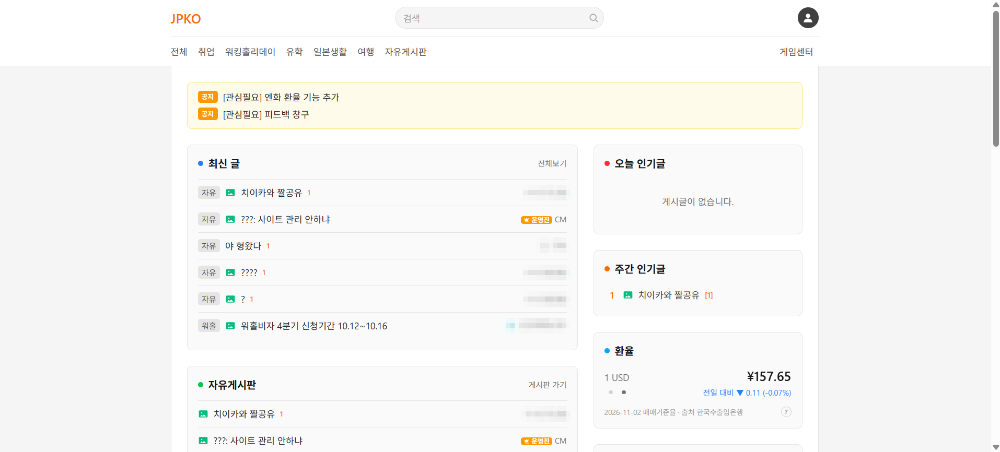
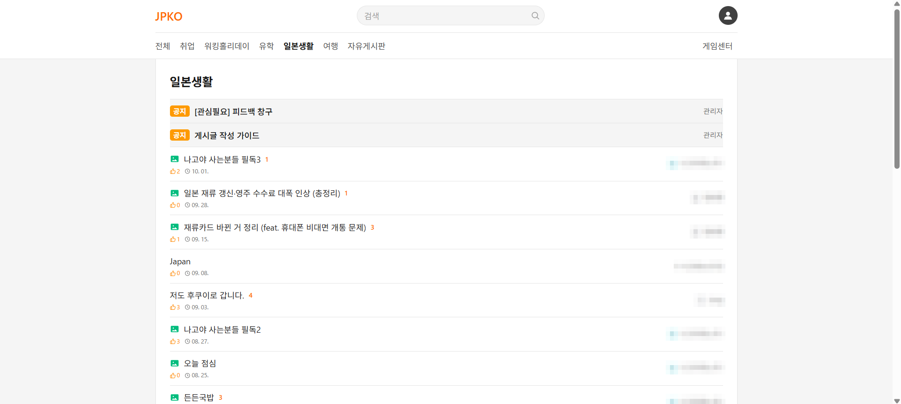
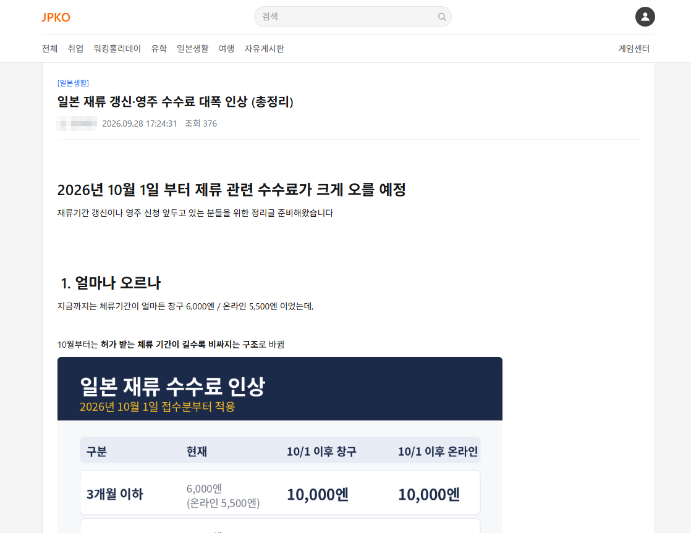
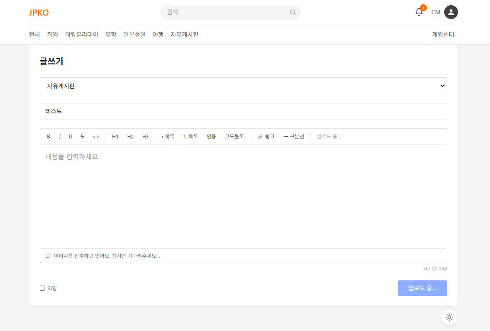
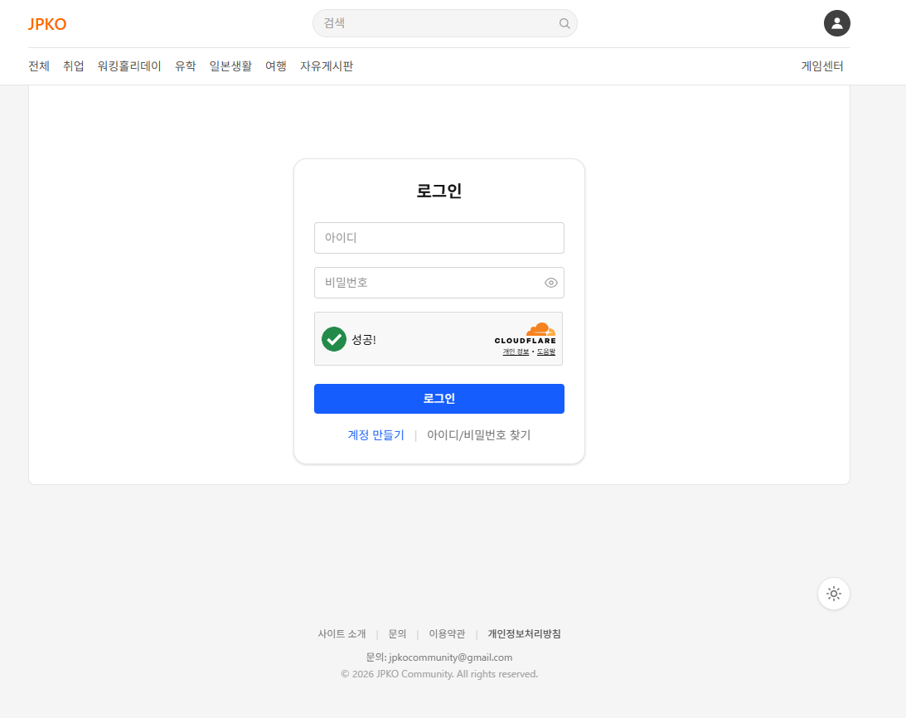

# jpkocommunity — Frontend

**日本語** | [한국어](README.ko.md)

日本での就職・ワーキングホリデー・留学・日本生活・旅行に関心のある韓国人向けコミュニティサービスのフロントエンドです。
企画から設計、開発、デプロイ、運用までを1人で行いました。

> **📦 運用終了のお知らせ**
> 本サービスは2026年6月から11月まで実際に運用し、**2026-11-24 に運用を終了**しました。
> 現在は、投稿を作成者情報なしで表示する読み取り専用のアーカイブに切り替えています。

- バックエンド: [ahdeka/jpko-community](https://github.com/ahdeka/jpko-community)
- サービス: https://www.jpkocommunity.site (アーカイブ)

---

## 設計書

設計資料はバックエンドのリポジトリにまとめています。画面に関するものは次の2つです。

| 資料 | 内容 |
| --- | --- |
| [画面遷移図](https://github.com/ahdeka/jpko-community/blob/main/docs/design/screen-transition.pdf) | 全画面の遷移図、遷移一覧、アクセス制御 |
| [画面設計書](https://github.com/ahdeka/jpko-community/blob/main/docs/design/screen-design.pdf) | 31画面と共通部品の画面イメージ・項目定義 |

基本設計書・詳細設計書・API仕様書・テーブル定義書・機能一覧は、[バックエンドの README](https://github.com/ahdeka/jpko-community#設計書) から参照できます。

---

## スクリーンショット

| メイン | カテゴリ |
|---|---|
|  |  |

| 投稿詳細 | 投稿エディタ |
|---|---|
|  |  |

| ログイン(Cloudflare Turnstile) | |
|---|---|
|  | |

> 会員のニックネームと IP の表示は、個人情報保護のためモザイク処理しています。

---

## 技術スタック

| 領域 | 技術 |
|---|---|
| Framework | Next.js 16 (App Router), React 19, TypeScript |
| Styling | Tailwind CSS 4 |
| Editor | Tiptap 3(画像・動画挿入の拡張) |
| デプロイ | Vercel (Analytics, Speed Insights) |
| 外部 API | 韓国輸出入銀行 為替 Open API |

## 画面構成

| 領域 | パス |
|---|---|
| 掲示板 | `/posts`, `/posts/category/[slug]`, `/posts/[id]`, `/posts/search`, `/posts/new`, `/posts/[id]/edit` |
| お知らせ | `/notices`, `/notices/[id]` |
| 会員 | `/signup`, `/signup/[token]`, `/login`, `/find-account`, `/reset-password`, `/verify-email-change`, `/mypage`, `/users/[nickname]` |
| 通知 | `/notifications` |
| ゲームセンター | `/game-center/roulette`, `/game-center/pachinko`, `/game-center/slot` |
| 管理 | `/admin`, `/admin/reports`, `/admin/users`, `/admin/notices` |
| 案内 | `/terms`, `/privacy`, `/about`, `/contact` |

---

## 実装で工夫した点

### 1. 認証状態のちらつきをなくす
トークンは HttpOnly Cookie なので JS からは読めず、クライアントは `/me` の応答を受け取るまでログイン状態がわかりません。
そのため、ログイン済みの利用者が `/login` を開くと、ログイン画面が一瞬表示されてから移動する問題がありました。
**Next.js の Proxy(旧 Middleware)** で Cookie の有無だけを見て、描画前にリダイレクトすることで解決しました。実際の認可判定はバックエンドが担当し、フロントは楽観的なチェックだけを行います。

### 2. サーバー専用モジュールで API キーを保護
為替 API のキーには `NEXT_PUBLIC_` 接頭辞を付けず、クライアントのバンドルに含まれないようにして、サーバーコンポーネントからのみ呼び出しています。
`unstable_cache` で応答をキャッシュし、営業日に1回だけ更新されるデータを毎リクエスト取りに行かないようにしました。

### 3. API レイヤーの分離
`lib/api/` にドメイン別の API 関数を置き、クライアント用(`client.ts`)とサーバーコンポーネント用(`server.ts`)の呼び出しを分けました。
ブラウザの fetch は Cookie を自動で載せますが、サーバーコンポーネントの fetch は載せないため、サーバー側ではリクエストの Cookie をヘッダーで明示的に渡す必要があるためです。
アクセストークンが切れたときは、同時に複数の 401 を受けても再発行は1回だけ行い(single-flight)、元のリクエストを1回だけ再試行します。

### 4. 検索エンジンのインデックス制御
`NEXT_PUBLIC_ALLOW_INDEXING=true` のときだけインデックスを許可し、プレビューのデプロイが検索結果に出ないようにしました。
本番環境では sitemap と robots.txt を通じて Google Search Console に登録しました。

---

## プロジェクト構成

```
app/          # App Router のページ
components/   # ドメイン別のコンポーネント(post, comment, admin, auth, layout ...)
lib/
├── api/      # バックエンド API の呼び出し(ドメイン別)
├── auth-context.tsx
└── ...       # 書式、レベル、通知、為替などのユーティリティ
types/        # 共通の型
proxy.ts      # 認証画面のリダイレクト
```

## ローカル実行

```bash
npm install
npm run dev   # http://localhost:3000
```

バックエンドのアドレスなどの環境変数は `.env.local` に設定します。
